Blueprint (First Person Shooter) sample
=======================================

This is a sample project to be used with `coreDS Unreal <https://www.ds.tools/products/hla-dis-unreal-engine-4/>`__ and `Unreal Engine <https://www.unrealengine.com>`__ 5.2 or later. You can request a free trial at https://www.ds.tools/contact-us/trial-request/

coreDS Unreal must already be installed and activated to use this project. coreDS Unreal is not enabled by default: the sample's ``coreDSFirstPerson.uproject`` already enables it (``coreDSModule``). If you copy this setup to your own project, enable coreDS Unreal in Edit > Plugins, or list ``coreDSModule`` in your ``.uproject``.

This sample uses Blueprints only. The base project is the First Person template provided by Epic Games.

The sample project uses the following coreDS concepts:

- Connect
- Disconnect
- Send Update Object (send EntityStatePDU, or RegisterObjectInstance and UpdateAttributeValues)
- Send Message (send a FirePDU or a WeaponFire interaction)
- Receive Update Object (receive EntityStatePDU, or DiscoverObjectInstance and ReflectAttributeValues)
- Receive Message (receive a FirePDU or a WeaponFire interaction)
- Delete Objects (EntityStatePDU timeout or RemoveObjectInstance)

Runtime commands:

- Pressing K stops the connection and opens the configuration selection window. This lets you switch from one distributed simulation protocol to the other without closing the application.

Getting started
---------------

The first step is to tell coreDS Unreal which objects, object attributes, messages and message parameters your simulator supports. The names you define are not related to the distributed simulation protocol you plan to use. They are only used internally, from Blueprints or the mapping interface.

This configuration is in Edit > Project Settings > Plugins > coreDS, in the Mapping category.

In this sample, we send and receive a Gun object with a location and an orientation, and a Bullet object with a location. The sample also sends and receives a ShotFired message with a location. Received entities that are neither a Gun nor a Bullet are received as EverythingElse.

The format of object and message names is NAME.PROPERTY. The object or message name is always the part before the first dot.

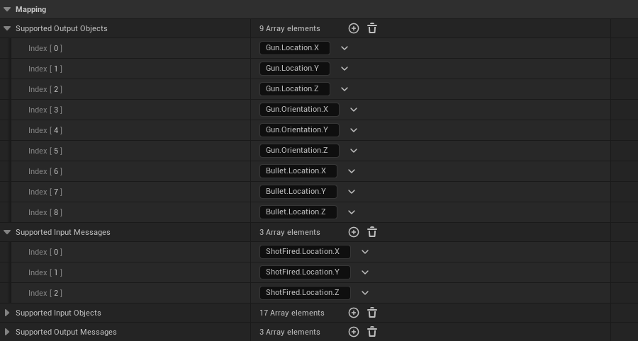

The next step is to configure an actual connection with a distributed simulation protocol. coreDS supports HLA (High-Level Architecture) and DIS (Distributed Interactive Simulation).

You can open the configuration window either by running the game or from Tools > Distributed Simulation > coreDS Unreal > Show coreDS UI.

This sample comes with 3 preconfigured configurations, in ``Content/coreDS``:

- ``DIS.coreDS``: DIS v5
- ``Player1.coreDS``: HLA 1516e with the RPR FOM 2.0
- ``Player2.coreDS``: HLA 1516e with the RPR FOM 2.0

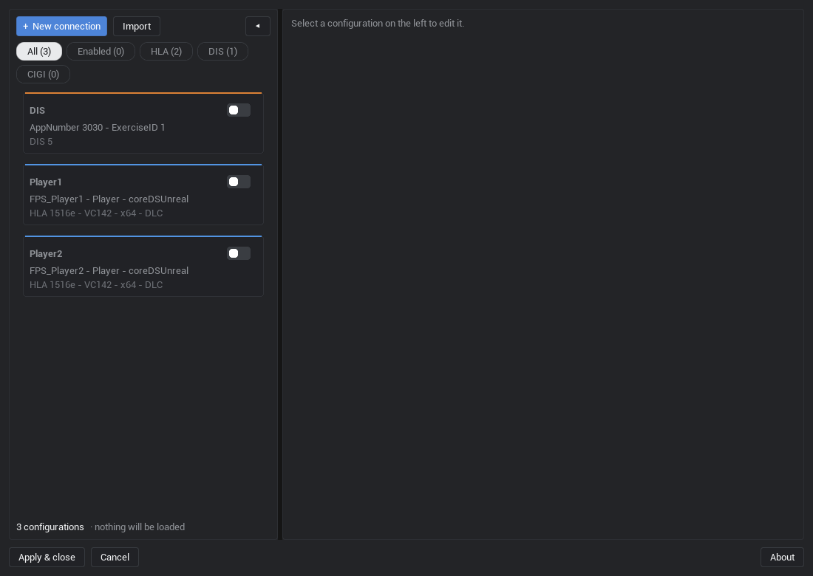

The FOM files are given by name only. The DIS configuration uses ``DIS_V5_IEEE_1278.1-1995_expert.xml``, shipped with coreDS Unreal in the plugin's ``ThirdParty/coreDS/bin`` folder (``coreDSModule/ThirdParty/coreDS/bin/VC143/x64/Release`` on Windows). The HLA configurations use the RPR FOM shipped with the sample, ``Content/coreDS/RPR_FOM_v2.0_1516-2010.xml``, next to the configurations.

All the coreDS Unreal samples can run at the same time and see each other's entities. Their DIS configurations are DIS 5 on port 3000, exercise 1, listen on every network adapter (``0.0.0.0``) and broadcast to ``255.255.255.255``; each sample has its own Application Number (Automatic Mode 3010, Model Integration 3020 and 3021, First Person Shooter 3030, C++ 3040, Cesium 3050), since two simulators with the same Site and Application Numbers get their entities mixed up. Their HLA configurations join the ``coreDSUnreal`` federation with the RPR FOM 2.0 through the DLC (Dynamic Link Compatible) 1516e plugin, each with its own federate name.

Let's take a look at each configuration.

DIS
~~~

Configure the network adapter: click the "Network Interface Address" drop-down list and select your active network adapter. Set the destination address for your network too.

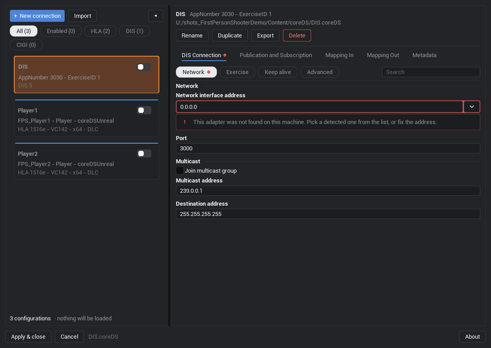

Receiving
^^^^^^^^^

Even if DIS does not explicitly support subscriptions, coreDS supports incoming filtering. First, we must let coreDS know that we want to receive the EntityStatePDU and the FirePDU.

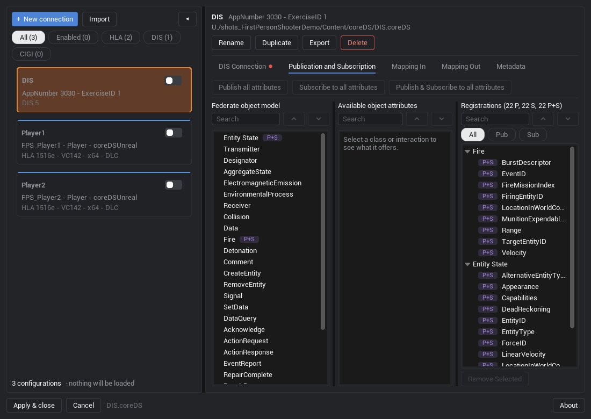

Then comes the mapping configuration. To receive, we care about the "Mapping In".

The first step is to map a protocol object or message to a local object or message. The names you defined in the settings are listed in the drop-down list next to each protocol object or message: link Entity State to Gun, Bullet and EverythingElse, and Fire to ShotFired.

Then you must map the local properties to the protocol properties. When receiving, we only map the values we are interested in: here, the location and the orientation.

Finally, we receive coordinates in geocentric format, which Unreal doesn't use. We could convert the coordinates in Unreal, but that would make it harder to switch to a different distributed simulation protocol. To keep everything configurable at runtime, we use the Lua scripting engine embedded in coreDS to convert from geocentric coordinates to flat coordinates centred on the reference latitude and longitude.

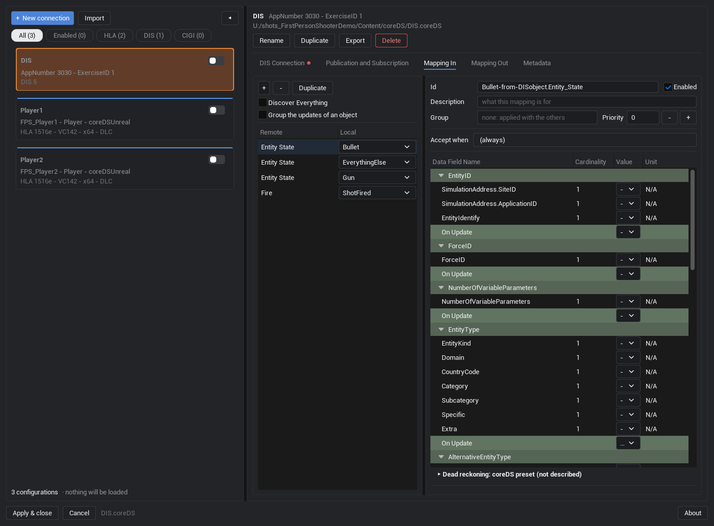

Below is ``convertPositionFromDISToUnreal.lua``, the "On Data Received" script of the location. It converts the location and the orientation. Unreal X is north and Y is east, and Unreal units are centimetres. Scripts are located in ``Content/coreDS/Script``.

.. code-block:: lua

   require("ReferenceLatLongAlt")
   angleConversions = require("angleConversions")
   require("ecef2lla")

   function convertPositionFromDISToUnreal(value)

      -- Since we are working over a fairly small part of the planet, we can assume a flat surface
      a, b, c = EcefToEnu(value['LocationInWorldCoordinates.X']:toFloat(), value['LocationInWorldCoordinates.Y']:toFloat(), value['LocationInWorldCoordinates.Z']:toFloat(), referenceOffset_Lat , referenceOffset_Long , referenceOffset_Alt )

      --convert geocentric to lat/long
      lat, long, alt = ecef2lla(value['LocationInWorldCoordinates.X']:toFloat(), value['LocationInWorldCoordinates.Y']:toFloat(), value['LocationInWorldCoordinates.Z']:toFloat())

      lat = 0.0174532925 * lat  -- convert to radian
      long = 0.0174532925 * long  -- convert to radian

      yaw = angleConversions.getOrientationFromEuler(lat, long, value['Orientation.Psi']:toFloat(), value['Orientation.Theta']:toFloat())
      pitch = angleConversions.getPitchFromEuler(lat, long, value['Orientation.Psi']:toFloat(), value['Orientation.Theta']:toFloat())
      roll = angleConversions.getRollFromEuler(lat, long, value['Orientation.Psi']:toFloat(), value['Orientation.Theta']:toFloat(), value['Orientation.Phi']:toFloat())

      value['Orientation.Psi']:set(roll)
      value['Orientation.Theta']:set(pitch)
      value['Orientation.Phi']:set(yaw)

      --scale back from meter to cm
      value['LocationInWorldCoordinates.X']:set(b*100)
      value['LocationInWorldCoordinates.Y']:set(a*100)
      value['LocationInWorldCoordinates.Z']:set(c*100)

   end

``EcefToEnu`` returns east, north and up, in metres: the script multiplies them by 100 and sets north as Unreal X and east as Unreal Y.

The configuration never uses the EntityType to tell a Gun from a Bullet. coreDS supports complex filtering with its Lua scripting engine. To filter the Guns, the "On Data Received" script of the EntityType group is ``FilterGun.lua``: it checks the EntityType and tells coreDS to discard the update when it is not a Gun (``3.1.``, a land life form). ``FilterBullet.lua`` keeps the ``2.1.`` munitions, and ``FilterAllExceptBulletAndGun.lua`` keeps everything else for EverythingElse.

.. code-block:: lua

   require("__concatenateEntityType")

   function startswith(text, prefix)
       return text:find(prefix, 1, true) == 1
   end

   function FilterGun (value)
      -- if Plateform of type munition

      entitykind = __concatenateEntityType(value)

      if(startswith(entitykind, "3.1.") ~= true) then
         return true
      end
   end

Sending
^^^^^^^

Then, we must let coreDS know that we want to send the EntityStatePDU and the FirePDU. They are on the same Publication and Subscription tab as the received PDUs (see the screenshot above).

Then comes the mapping configuration. To send, we care about the "Mapping Out".

The first step is to map a local object or message to a protocol object or message. The names you defined in the settings are listed in the "+" list. Link each local object or message to a protocol object or message with the drop-down list next to its name.

Then you must map the local properties to the protocol properties. When sending, you must fill the complete structure. Static values can be set at this point. Map Location and Orientation to the local properties.

Finally, we send coordinates in local format, which DIS doesn't use. To keep everything configurable at runtime, we use the Lua scripting engine embedded in coreDS to convert from flat coordinates, centred on the reference latitude and longitude, to geocentric coordinates.

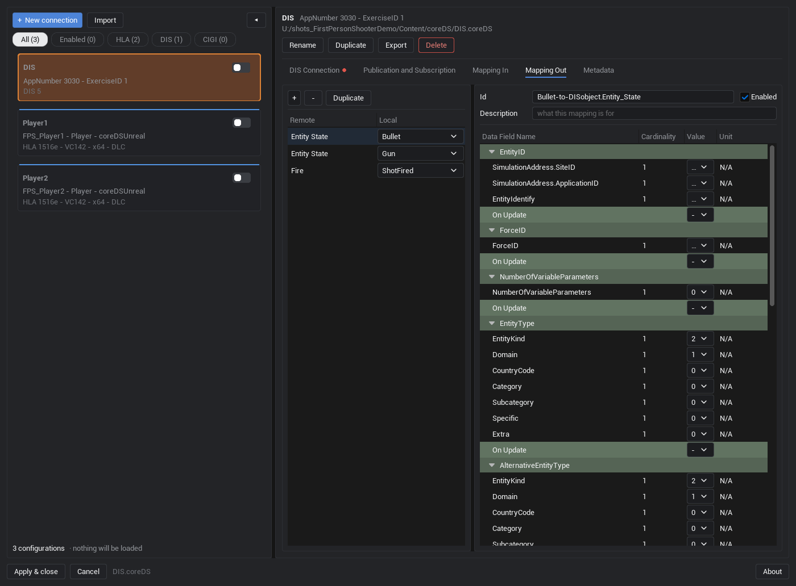

The "On Data Updated" script of the location is ``convertUnrealPositionToDIS.lua``, and the one of the orientation is ``convertOrientationFromUnrealToDIS.lua``. The location script divides the Unreal centimetres by 100 and passes east (Unreal Y) and north (Unreal X) to ``EnuToEcef``:

.. code-block:: lua

   require("ReferenceLatLongAlt")

   lastPositionX = 0
   lastPositionY = 0
   lastPositionZ = 0

   function convertUnrealPositionToDIS(value)

      lastPositionX = value['X']:toFloat();
      lastPositionY = value['Y']:toFloat();
      lastPositionZ = value['Z']:toFloat();

      -- Since we are working over a fairly small part of the planet, we can assume a flat surface
      --convert lat/long to geocentric
      a, b, c = EnuToEcef(lastPositionY/100, lastPositionX/100, lastPositionZ/100, referenceOffset_Lat , referenceOffset_Long , referenceOffset_Alt )

      value['X']:set(a)
      value['Y']:set(b)
      value['Z']:set(c)

      lastPositionX = a
      lastPositionY = b
      lastPositionZ = c

   end

HLA
~~~

For both configurations, you need a valid FOM file. The sample provides an RPR FOM 2.0 compliant FOM file, ``Content/coreDS/RPR_FOM_v2.0_1516-2010.xml``. Although this sample is configured for the RPR FOM, you can load the FOM file of your choice.

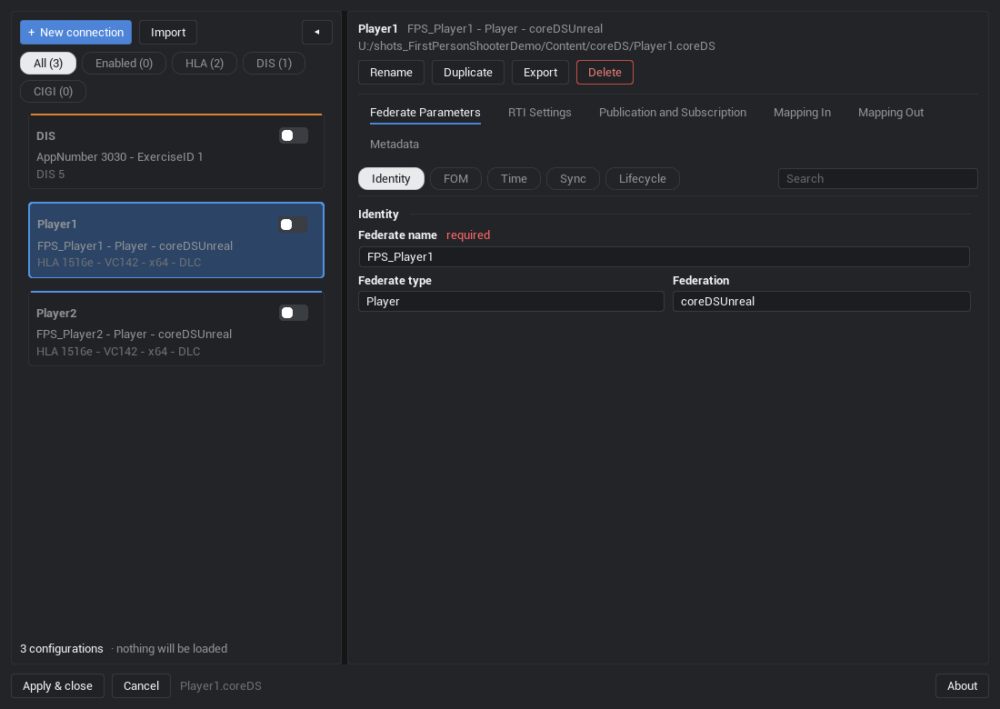

coreDS supports a wide range of RTIs, from the legacy DMSO RTI (HLA 1.3) to HLA 1516e compliant RTIs like the Pitch RTI or the MAK RTI. The complete list of supported RTIs can be found at https://www.ds.tools/products/coreds/detailed-features-list/

If you are using the default configuration, you must select an HLA Evolved (1516e) compliant RTI.

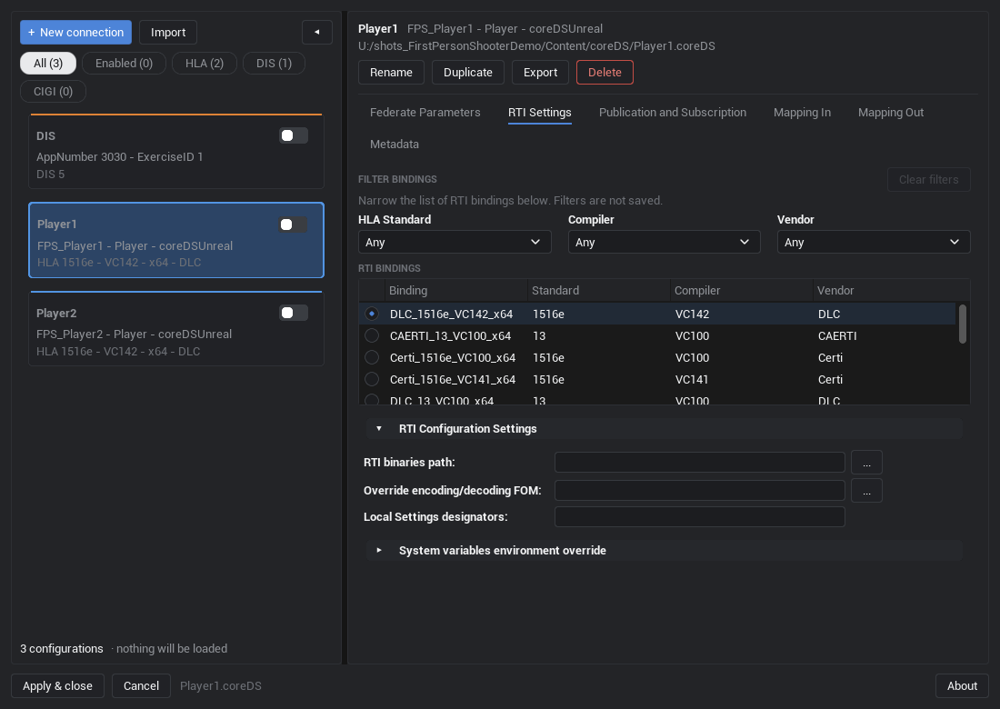

Receiving
^^^^^^^^^

First, we must let coreDS know that we want to receive the Spatial attribute of HLAobjectRoot.BaseEntity.PhysicalEntity.Lifeform and HLAobjectRoot.BaseEntity.PhysicalEntity.Munition, and the WeaponFire interaction.

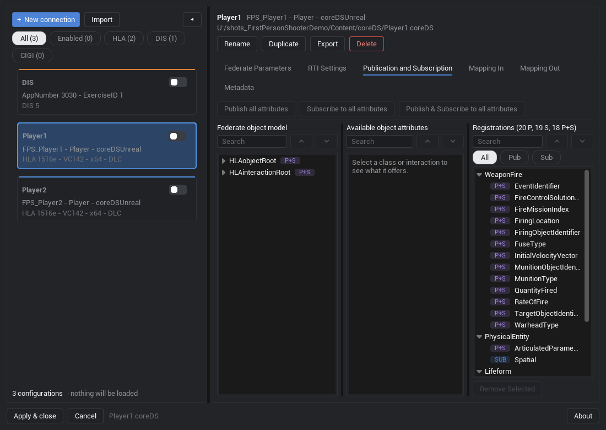

Then comes the mapping configuration. To receive, we care about the "Mapping In".

The first step is to map a protocol object or message to a local object or message: Lifeform to Gun, Munition to Bullet, PhysicalEntity to EverythingElse and WeaponFire to ShotFired.

Then you must map the local properties to the protocol properties. When receiving, we only map the values we are interested in: here, the location and the orientation of the Spatial attribute.

Finally, we receive coordinates in geocentric format, which Unreal doesn't use. To keep everything configurable at runtime, we use the Lua scripting engine embedded in coreDS to convert from geocentric coordinates to flat coordinates centred on the reference latitude and longitude.

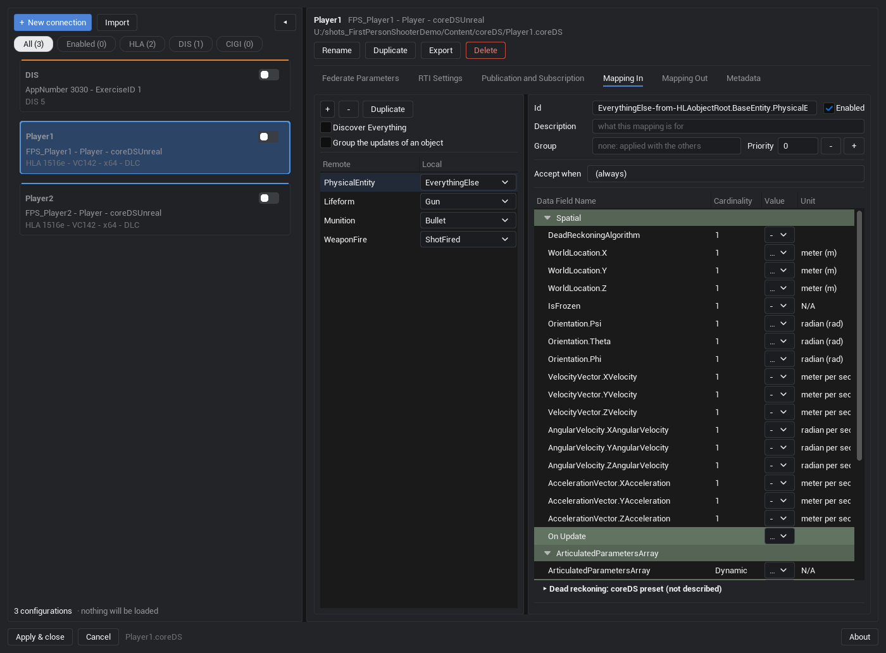

Below is ``convertPositionFromHLAToUnreal.lua``, the "On Data Received" script of the Spatial attribute. The WeaponFire location uses ``convertPositionFromHLAToUnrealForInteraction.lua``, which applies the same location conversion. Scripts are located in ``Content/coreDS/Script``.

.. code-block:: lua

   angleConversions = require("angleConversions")
   require("ecef2lla")
   require("ReferenceLatLongAlt")

   function convertPositionFromHLAToUnreal(value)
      -- Since we are working over a fairly small part of the planet, we can assume a flat surface
      a, b, c = EcefToEnu(value['WorldLocation.X']:toFloat(), value['WorldLocation.Y']:toFloat(), value['WorldLocation.Z']:toFloat(), referenceOffset_Lat , referenceOffset_Long , referenceOffset_Alt )

      --convert geocentric to lat/long
      lat, long, alt = ecef2lla(value['WorldLocation.X']:toFloat(), value['WorldLocation.Y']:toFloat(), value['WorldLocation.Z']:toFloat())

      lat = 0.0174532925 * lat  -- convert to radian
      long = 0.0174532925 * long  -- convert to radian

      yaw = angleConversions.getOrientationFromEuler(lat, long, value['Orientation.Psi']:toFloat(), value['Orientation.Theta']:toFloat())
      pitch = angleConversions.getPitchFromEuler(lat, long, value['Orientation.Psi']:toFloat(), value['Orientation.Theta']:toFloat())
      roll = angleConversions.getRollFromEuler(lat, long, value['Orientation.Psi']:toFloat(), value['Orientation.Theta']:toFloat(), value['Orientation.Phi']:toFloat())

      value['Orientation.Psi']:set(roll)
      value['Orientation.Theta']:set(pitch)
      value['Orientation.Phi']:set(yaw)

      --scale back from meter to cm
      value['WorldLocation.X']:set(b*100)
      value['WorldLocation.Y']:set(a*100)
      value['WorldLocation.Z']:set(c*100)

   end

Sending
^^^^^^^

First, we must let coreDS know that we want to send the Spatial attribute of the same object classes and the WeaponFire interaction (see the publication and subscription screenshot above).

Then comes the mapping configuration. To send, we care about the "Mapping Out": Gun to Lifeform, Bullet to Munition and ShotFired to WeaponFire.

Then you must map the local properties to the protocol properties. When sending, you must fill the complete structure. Static values can be set at this point. Map the location and the orientation of the Spatial attribute to the local properties.

Finally, we send coordinates in local format, which the RPR FOM Spatial attribute does not use. To keep everything configurable at runtime, we use the embedded Lua scripting engine to convert from flat coordinates, centred on the reference latitude and longitude, to geocentric coordinates.

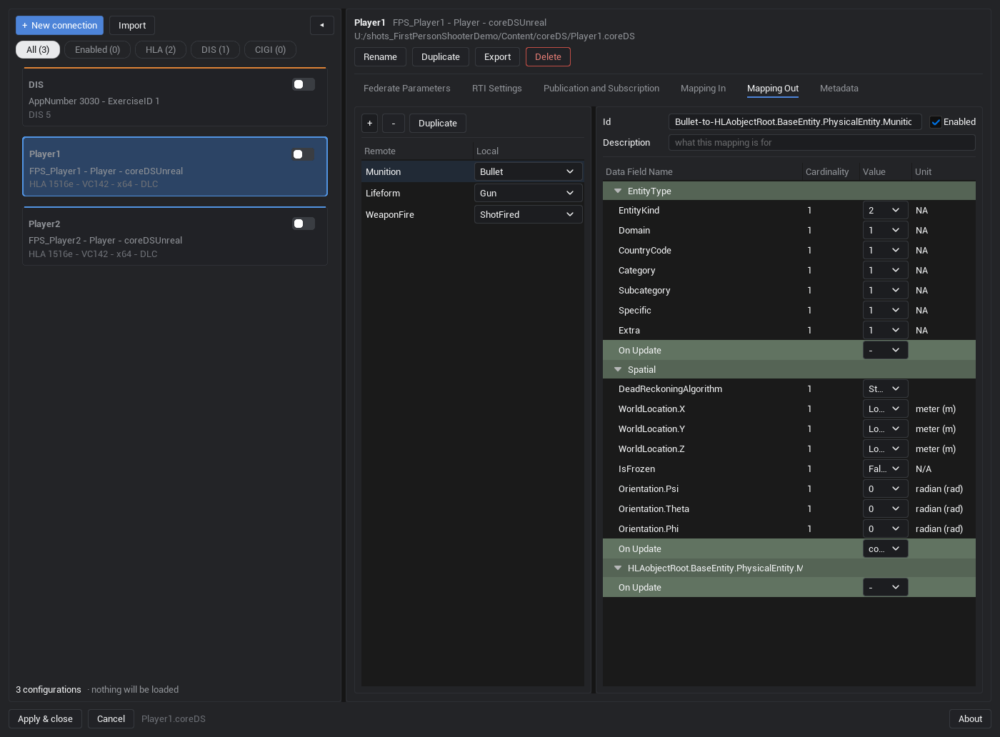

The "On Data Updated" script of the Spatial attribute is ``convertUnrealPositionToHLA.lua``, which converts the location and the orientation, and the one of the WeaponFire location is ``convertUnrealPositionToHLAForInteraction.lua``. As for DIS, they divide the Unreal centimetres by 100 and pass east (Unreal Y) and north (Unreal X) to ``EnuToEcef``. Scripts are located in ``Content/coreDS/Script``.

Blueprint functions
-------------------

The coreDS Unreal Blueprint functions (Connect, Disconnect, Update Object, Send Message, Delete Object and the Register … Handler functions) belong to the coreDS Engine, a game instance subsystem. In a Blueprint, get it with the "coreDS Engine" (Get Game Instance Subsystem) node and connect it to the function's Target pin. Object and message values are passed as a coreDS variant.

The Blueprint screenshots below come from an earlier version of the sample: they do not show the Target pin and use arrays of name/value pairs. The sample's Blueprints use the current functions.

Connect
-------

At some point, your simulator must connect to the distributed simulation (HLA or DIS). With DIS, a UDP socket is created. With HLA, a connection to the RTI is attempted: if supported by the HLA version you are using, connect() is called, followed by createFederationExecution (this call can be disabled in the HLA configuration) and joinFederationExecution. Once the federation is joined, the required states, such as time management and publication and subscription, are set.

In this sample, "Connect On Start" is off in the Runtime category of the coreDS settings, and the Level Blueprint connects on BeginPlay:

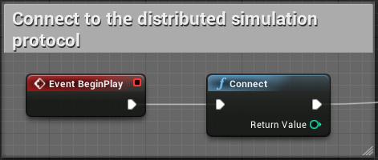

Disconnect
----------

When disconnecting, a DIS configuration closes the socket. HLA calls resignFederationExecution and destroyFederationExecution.

From the Level Blueprint:

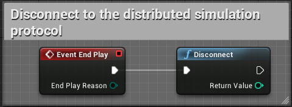

Send Update Object (send EntityStatePDU or UpdateAttributeValues)
-----------------------------------------------------------------

To send an object update, build the values, then call Update Object with a unique object name, the object type and the values. All names must match the names configured in the coreDS Unreal settings.

With HLA, the first call for an object registers it (registerObjectInstance), and each call sends updateAttributeValues.

With DIS, an EntityStatePDU is sent.

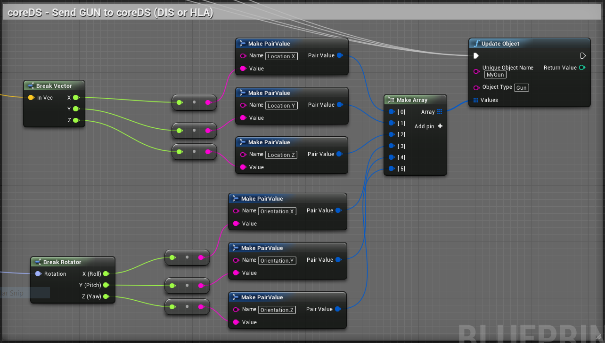

Send Message (send a FirePDU or a WeaponFire interaction)
---------------------------------------------------------

Sending a message works the same way: build the values, then call Send Message. All names must match the names configured in the coreDS Unreal settings.

With HLA, a WeaponFire interaction is sent.

With DIS, a FirePDU is sent.

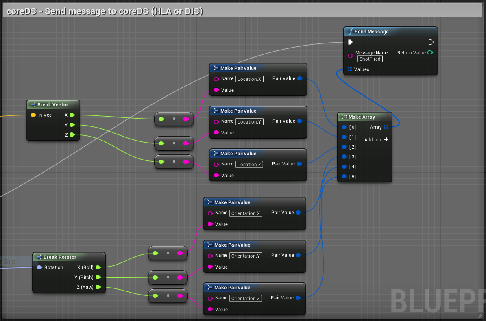

Receive Update Object (receive EntityStatePDU or ReflectAttributeValues)
------------------------------------------------------------------------

To receive object updates, register an object update handler for an object name of the coreDS Unreal settings:

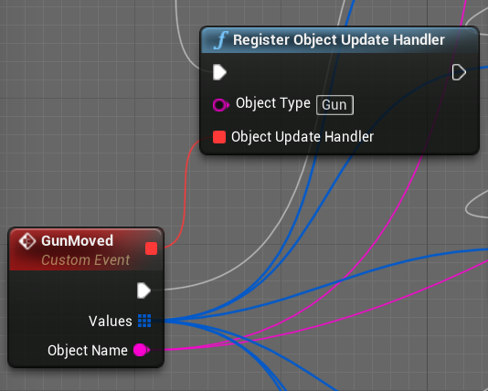

Then, each time a Gun is received, the GunMoved event is triggered.

The sample also keeps a map of the discovered objects. If the object name is not in the map yet, a new actor is spawned; otherwise, the existing actor is updated. You will most likely need to adapt that part to your requirements.

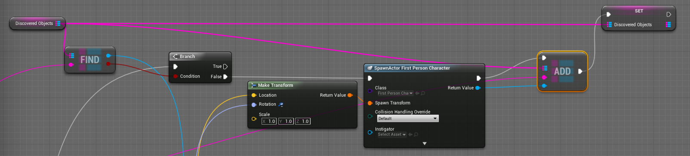

Below is how to read the received values. The property names are the ones configured in `Getting started`_.

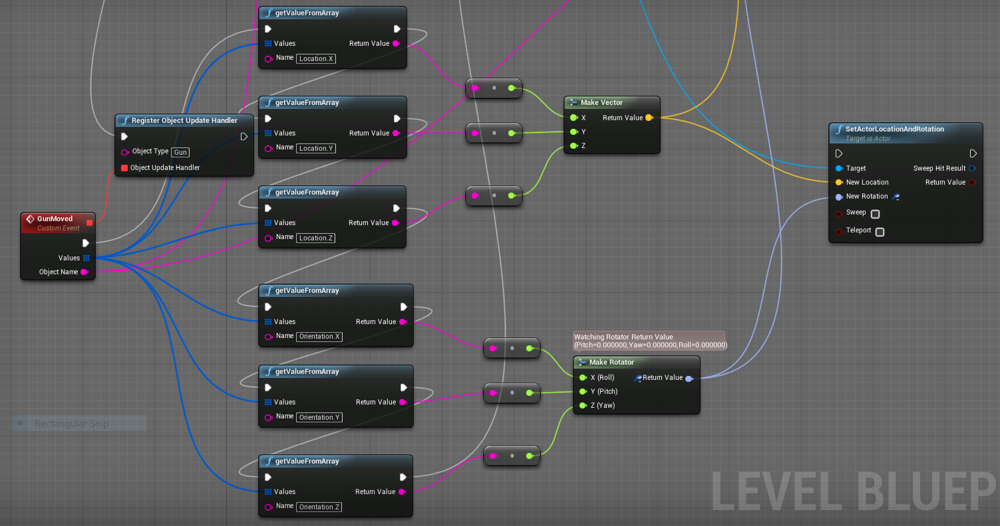

Receive Message (receive a FirePDU or a WeaponFire interaction)
---------------------------------------------------------------

To receive a message, register a message received handler. Then, each time a ShotFired message is received, the handler's event is triggered: here, it spawns a projectile and plays the firing sound.

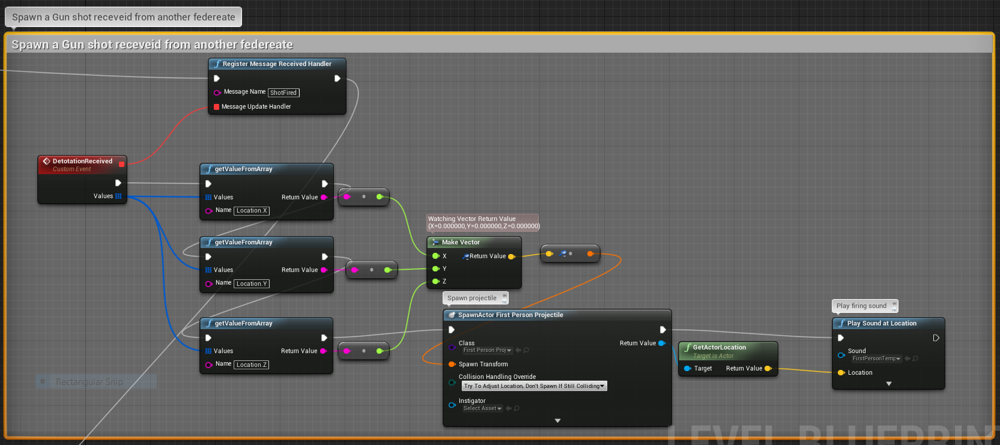

Delete Objects (deleteObjectInstance)
-------------------------------------

With DIS, you must tell coreDS when an object is no longer active; otherwise, coreDS keeps sending its keep-alive updates. With HLA, the object must be deleted from the federation.

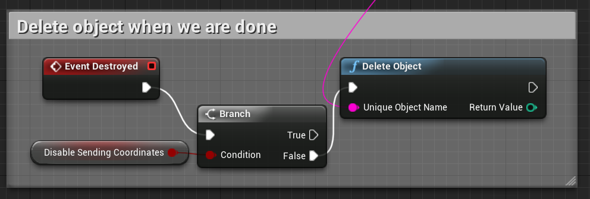

Detect Deleted Objects (EntityStatePDU timeout or RemoveObjectInstance)
-----------------------------------------------------------------------

Let's add a handler for objects removed from the distributed simulation. With DIS, this happens when the EntityStatePDU of an object has not been received for 5 seconds (or the configured value in DIS 7). With HLA, the handler is called when a removeObjectInstance callback is received.

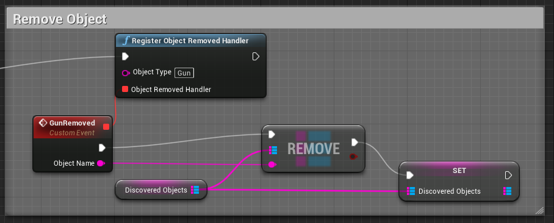

Blueprint locations
-------------------

Everything related to receiving objects and messages is in the Level Blueprint.

Sending the Gun location and the ShotFired message is in the FirstPersonCharacter Blueprint.

Sending the Bullet location is in the FirstPersonProjectile Blueprint.

Overriding the error message handler
------------------------------------

By default, errors are displayed in the upper left corner of the screen. Register an error handler to show them in a different UI.

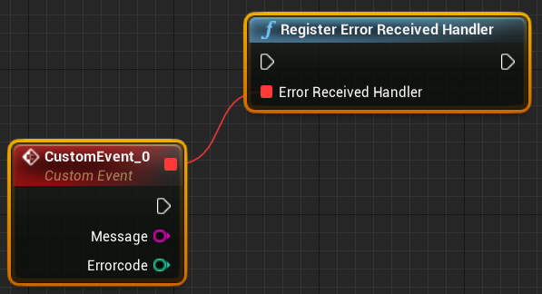

Setting your origin
-------------------

The Unreal world is flat, so its coordinates must be converted for DIS and HLA (RPR FOM). The conversion is centred on a reference location.

To set it, go to Edit > Project Settings > Plugins > coreDS and set "Reference Latitude", "Reference Longitude" and "Reference Altitude" in the Scene category.

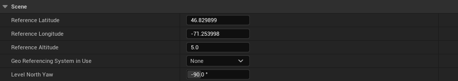
